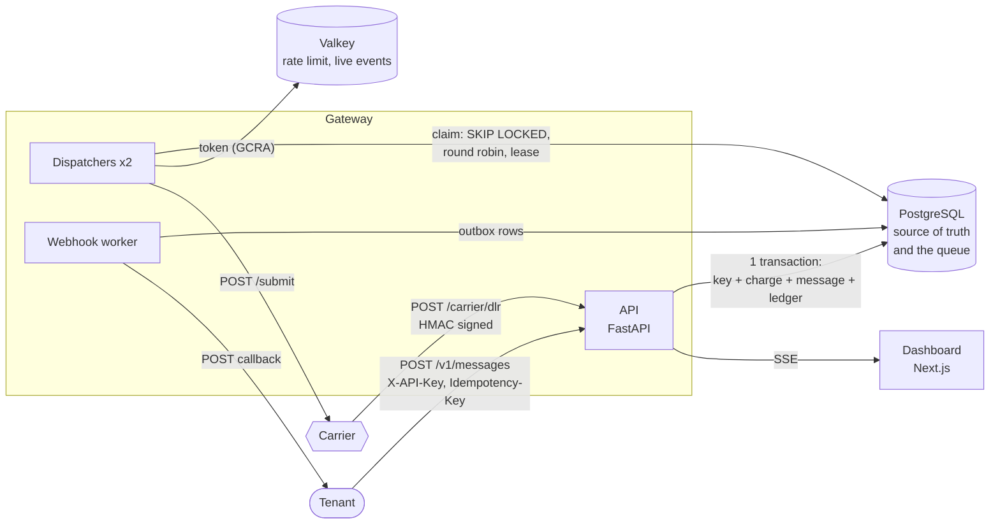

# Design note

## The shape of the system

Two decisions carry most of the weight.

**PostgreSQL is the queue.** A message row with `status = 'QUEUED'` is the queue
entry. Accepting a message, charging for it and enqueueing it are therefore one
transaction: there is no window where a message is charged but not queued, and
no second system to reconcile after a crash. A claim is one statement
(`FOR UPDATE SKIP LOCKED`) that pushes `next_attempt_at` forward by a lease, so a
dead worker's message becomes visible again by itself. The carrier allows 50
submits per second; PostgreSQL does that without effort. A Redis list would be
faster and would give me a dual-write problem I do not need at this volume.

**Valkey holds only what may be lost.** The carrier rate limit (one key, a GCRA
script, atomic across all workers) and the pub/sub channel for the dashboard.
If Valkey is wiped, the limiter restarts from "now" and the dashboard refetches.
No message and no money lives there.

**Status model.** I kept the states from the brief. `ACCEPTED` and `QUEUED` are
written in the same transaction, because with the queue in the database they are
the same instant; both events are recorded so the history is complete. Every
later change goes through one function, `transition()`, which is a
compare-and-set (`UPDATE ... WHERE status = ANY(allowed sources)`). A late or
repeated event finds no matching row and changes nothing. `UNIQUE (message_id,
status)` on the event table makes "each status at most once" a database fact.

## 1. The worker crashes after the carrier accepted. What happens?

Before the HTTP call, the claim has already committed three things: the attempt
counter, the lease, and a `submit_attempts` row with no outcome. That row is a
write-ahead record: "a submit for this message may be on the wire".

The crash leaves that row open. When the lease ends (30 s), another worker
claims the message. The claim statement sees the open attempt, marks it
`ABANDONED`, increments `messages.ambiguous_attempts`, and the message is
submitted again **with the same `message_id`**.

**Can the customer get the SMS twice? Yes**, if the carrier does not
de-duplicate on `message_id`. The gateway cannot tell: the DLR for the first
submit carries a `carrier_id` we never saw, so it is stored as an unmatched
receipt. A submit that times out is the same case and takes the same path
(`TIMEOUT` instead of `ABANDONED`).

What is guaranteed anyway: the message is not lost, it is charged once, and it
reaches one final status. What is left is a duplicate SMS, limited to messages
with an ambiguous attempt, and every one of them is flagged in the database and
in the dashboard. In the load run that is about 1% of messages (the carrier's
timeout share); the carrier's own `/stats` reports them as `duplicate_accepts`.

The only real fix needs the carrier: de-duplication on `message_id`, or a status
query. The mock has the first behind `IDEMPOTENT_SUBMIT=true`; with it on,
`duplicate_accepts` is 0 and the "lost" DLR is matched too, because the retry
returns the original `carrier_id`. I chose at-least-once over at-most-once
because the brief requires a retry on timeout and because a missing OTP is worse
than a repeated one. The policy is one table (`RULES` in `retry.py`).

One more consequence, stated plainly: if a message fails for good after an
ambiguous attempt, it is refunded, although the carrier may have delivered it.
I refund because I cannot prove delivery; the cost of that doubt is ours.

## 2. Where is it at-least-once, where exactly-once, and how do I know?

| Step | Guarantee | Enforced by | Test |
|---|---|---|---|
| Accept with `Idempotency-Key` | exactly once | PK `(tenant_id, key)` written in the accept transaction | `test_concurrent_requests_with_one_key_create_one_message` |
| Charge | exactly once | same transaction as the insert; `UNIQUE (message_id, kind)` | `test_concurrent_sends_cannot_overspend` |
| Refund | exactly once | only inside the `QUEUED -> FAILED` compare-and-set | `test_a_stale_worker_cannot_fail_a_message_that_was_reclaimed` |
| Submit to carrier | **at least once** | lease + retry; duplicates only after an ambiguous attempt | `test_a_message_claimed_by_a_dead_worker_is_recovered` |
| DLR | at least once in, exactly once in effect | `UNIQUE (carrier_id, status)` + compare-and-set | `test_ten_copies_of_a_dlr_at_once` |
| Early DLR | not lost | both sides take `pg_advisory_xact_lock(carrier_id)` before looking for each other | `test_dlr_and_submit_response_at_the_same_instant` |
| Tenant webhook | **at least once** | outbox row in the status transaction; stable `id` for the tenant to de-duplicate | `test_a_failing_endpoint_is_retried_then_succeeds` |
| Dashboard stream | at most once | best effort; the client refetches on reconnect | - |

"Exactly once" here always means "at-least-once delivery plus an idempotent
effect", and the idempotence is a constraint in the schema, not a check in
Python. The load script then verifies the money from outside, through the public
API: balance = opening balance - ledger, no message charged or refunded twice.

## 3. Fairness, and 50 tenants

A dispatcher claims **one** message, waits for a rate-limit token, and sends at
once. The claim picks, among tenants that have a message ready, the one served
longest ago (`dispatch_cursor`), then that tenant's oldest ready message. No
worker ever holds a batch, so an OTP that arrives in the middle of a
10,000-message campaign is behind at most one message per worker plus one slot
per active tenant. The limiter is GCRA, so slots are spaced about 22 ms apart
instead of arriving 50 at once each second. With two tenants and two workers the
OTP's wait is well under 100 ms plus the carrier's own latency; the README has
the measured p50 and p95.

The token is taken immediately before the HTTP call, not before the claim. The
carrier counts arrivals, and any work between "token granted" and "request sent"
delays some submits more than others, which can squeeze 51 arrivals into one
second out of correctly paced tokens. My first version did it the other way
round and the load test showed it: the carrier saw exactly 50 in its worst
second, with no margin left.

A retried message is older than the backlog behind it, so it goes back to the
front of its tenant's queue once its backoff has passed, not to the end.

With 50 tenants that all have a backlog, each gets 1/50 of the carrier: about
one message per second, and an OTP waits up to 50 slots, about 1.1 s. That is
tested (`test_fairness_with_fifty_tenants`). What this does **not** do: shares
are equal, not weighted, and an OTP is not preferred over another tenant's bulk
message. The next step is a weight per tenant (deficit round robin) and a
traffic class per message, so that transactional traffic keeps a reserved share
of the carrier. The claim probes each tenant once; for thousands of tenants I
would keep the set of active tenants in Valkey instead.

## 4. What breaks first at 1,000 messages per second?

**The carrier.** At 50 submits per second, 950 messages per second go to the
backlog and never come out. Nothing in the gateway matters until there is more
carrier capacity: more binds or more carriers, one limiter key per carrier, and
routing by prefix with failover.

After that, in the order I expect them to hurt:

1. **The claim.** One statement and one cursor update per message. I would
   claim in batches and assign tenants to workers, so there is no shared row.
2. **The balance row.** Every charge for a tenant locks one row. Batches already
   amortise this (one lock per 1,000 messages); single sends at high rate need
   credit reserved in blocks per API process.
3. **Table churn.** Each message row is updated three to four times and the
   queue index is rewritten each time. Partition `messages` and its events by
   day, and move the hot queue to a log (Kafka or Redis Streams, partitioned by
   tenant) with PostgreSQL staying the system of record through an outbox.
4. **Dashboard counts.** `count(*) GROUP BY status` once per second is fine for
   100,000 rows and wrong for 100 million. Replace with maintained counters.

## Assumptions and trade-offs

- A batch is atomic: one invalid number rejects all 1,000. Simple and safe for
  money; a per-message result would be friendlier for large campaigns.
- "70 / 67 characters" for UCS-2 means UTF-16 code units, so an emoji counts as
  two, and a two-unit character is never split across segments.
- Retries count toward `max_attempts` (6) whatever the cause, including 429.
- A message keeps the price it was accepted at; the price table is cached for
  30 s per API process.
- Callback URLs are not checked against private address ranges (SSRF). A real
  deployment must do that.
- API keys are stored as SHA-256. There is no key rotation and no top-up API.
