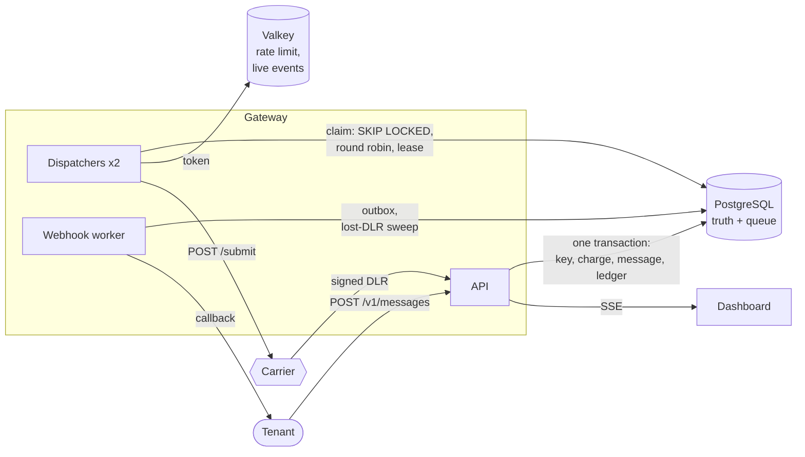

# Design note

**PostgreSQL is the queue.** A message row with `status = 'QUEUED'` is the queue
entry, so accepting, charging and enqueueing are one transaction. There is no
moment where a message is charged but not queued, and no second system to
reconcile after a crash. A claim is one `FOR UPDATE SKIP LOCKED` statement that
pushes `next_attempt_at` forward by a lease; a dead worker's message becomes
visible again by itself. The carrier allows 50 submits per second, which
PostgreSQL does without effort. A Redis queue would be faster and would give me
a dual-write problem I do not need at this volume.

**Valkey holds only what may be lost:** the carrier rate limit (one key, a GCRA
script, atomic across workers) and the dashboard's pub/sub channel. No message
and no money lives there.

**Status.** I kept the states from the brief. `ACCEPTED` and `QUEUED` are written
together, because with the queue in the database they are the same instant; both
events are recorded. Every later change goes through one function,
`transition()`: `UPDATE ... WHERE status = ANY(allowed sources)`. A late or
repeated event matches no row. `UNIQUE (message_id, status)` on the event table
makes "each status at most once" a database fact.

## 1. The worker crashes after the carrier accepted

Before the HTTP call, the claim has committed the attempt counter, the lease,
and a `submit_attempts` row with no outcome: a write-ahead record that a submit
may be on the wire. After the crash that row stays open. When the lease ends
(30 s) another worker claims the message; the claim statement marks the open
attempt `ABANDONED`, increments `messages.ambiguous_attempts`, and the message
is submitted again with the same `message_id`.

**Can the customer get the SMS twice? Yes**, if the carrier does not
de-duplicate on `message_id`. The gateway cannot know: the first submit's DLR
carries a `carrier_id` we never saw and is stored unmatched. A timeout is the
same case and takes the same path.

What holds anyway: the message is not lost, is charged once, and reaches one
final status: the one its DLR reports or, if no DLR arrives within the
carrier's validity period (`DLR_WAIT_SECONDS`, 24 hours), `EXPIRED` with reason
`NO_DLR`, set by a sweep in the webhook process. What is left is a duplicate
SMS, only for messages with an ambiguous attempt, each one flagged in the
database and the dashboard. In the load run that is about 1% (the carrier's
timeout share), and the carrier's `/stats` reports the same number as
`duplicate_accepts`.

The real fix needs the carrier: de-duplication on `message_id` or a status
query. The mock has the first behind `IDEMPOTENT_SUBMIT=true`; then duplicates
are 0 and the "lost" DLR is matched too, because the retry returns the original
`carrier_id`. I chose at-least-once because the brief requires a retry on
timeout and a missing OTP is worse than a repeated one. The policy is one table
(`RULES` in `retry.py`). One consequence: a message that fails for good after
an ambiguous attempt is refunded although the carrier may have delivered it. I
cannot prove delivery, so that doubt is ours to pay for. The proof can still
arrive later: a worker that outlives its lease can record the carrier's
acceptance after another attempt failed and refunded the message. The message
stays `FAILED` and refunded (a final status is final, and the tenant has its
webhook); the case is logged as an error, counted in
`smsgw_accepted_after_failed_total`, and visible as an `ACCEPTED` attempt on a
message with `ambiguous_attempts > 0`
(`test_a_late_acceptance_after_the_message_failed_moves_no_money`).

## 2. At-least-once and exactly-once

| Step | Guarantee | Enforced by | Test |
|---|---|---|---|
| Accept with `Idempotency-Key` | exactly once | PK `(tenant_id, key)` in the accept transaction | `test_concurrent_requests_with_one_key_create_one_message` |
| Charge | exactly once | same transaction; `UNIQUE (message_id, kind)` | `test_concurrent_sends_cannot_overspend` |
| Refund | exactly once | only inside the `QUEUED -> FAILED` compare-and-set | `test_a_stale_worker_cannot_fail_a_message_that_was_reclaimed` |
| Submit to carrier | **at least once** | lease and retry | `test_a_message_claimed_by_a_dead_worker_is_recovered` |
| DLR | at least once in, exactly once in effect | `UNIQUE (carrier_id, status)` + compare-and-set | `test_ten_copies_of_a_dlr_at_once` |
| Early DLR | not lost | both sides take `pg_advisory_xact_lock(carrier_id)` before looking for each other | `test_dlr_and_submit_response_at_the_same_instant` |
| Tenant webhook | **at least once** | outbox row in the status transaction; stable `id` | `test_a_failing_endpoint_is_retried_then_succeeds` |
| Dashboard stream | at most once | best effort; the client refetches | - |

"Exactly once" always means at-least-once delivery plus an idempotent effect,
and the idempotence is a constraint in the schema, not a check in Python. The
load script then verifies the money from outside, through the public API.

## 3. Fairness, and 50 tenants

A dispatcher claims one message, takes a rate-limit token, and sends at once.
The claim picks, among tenants with a message ready, the one served longest ago
(`dispatch_cursor`), then that tenant's oldest ready message. No worker holds a
batch, so an OTP that arrives during a 10,000-message campaign is behind at
most one message per dispatcher lane (two lanes per worker) and one slot per
active tenant. The limiter is GCRA:
slots are about 22 ms apart instead of 50 at the top of each second. A retried
message is older than the backlog behind it, so it returns to the front of its
tenant's queue after its backoff.

The token is taken right before the HTTP call because the carrier counts
arrivals. My first version took it before the claim; the load test showed the
carrier at exactly 50 in its worst second, because the claim's variable delay
squeezed correctly paced tokens together. Now it peaks at 48.

With 50 tenants that all have a backlog, each gets 1/50 of the carrier, and an
OTP waits up to 50 slots, about 1.1 s (`test_fairness_with_fifty_tenants`).
Shares are equal, not weighted, and an OTP is not preferred over another
tenant's bulk message. Next: a weight per tenant and a traffic class per
message, so transactional traffic keeps a reserved share. The claim makes one
probe into the queue index per tenant and stops at that tenant's first ready
message, so the backlog behind that message does not add to its cost. It still
reads the leased or backing-off rows in front of the first ready one: with
100,000 messages queued for one tenant, it took 0.27 ms with 300 leased rows at
the front and 0.51 ms with 5,000. Behind 100,000 already sent it took 0.30 ms
after a vacuum and 1.35 ms before one (an earlier version walked the primary key
past every sent message: 13 and 20 ms). For thousands of tenants I would keep
the active set in Valkey.

## 4. What breaks first at 1,000 messages per second

**The carrier.** At 50 submits per second, 950 messages per second join a
backlog that never drains. Nothing else matters until there are more carriers,
one limiter key per carrier, and routing with failover.

After that, in the order I expect them to hurt:

1. **The claim**: one statement and one cursor update per message. Claim in
   batches and assign tenants to workers, so no row is shared.
2. **The balance row**: every charge for a tenant locks it. Batches amortise
   this; single sends at high rate need credit reserved in blocks per process.
3. **Table churn**: each message row is updated three to four times and its
   queue index entry with it. Partition by day; move the hot queue to a log
   (Kafka or Redis Streams, partitioned by tenant) with PostgreSQL as the system
   of record through an outbox.
4. **Dashboard counts**: `count(*) GROUP BY status` every second is fine for
   100,000 rows and wrong for 100 million. Keep counters instead.

Assumptions and trade-offs are listed in the [README](README.md#assumptions-and-trade-offs).
